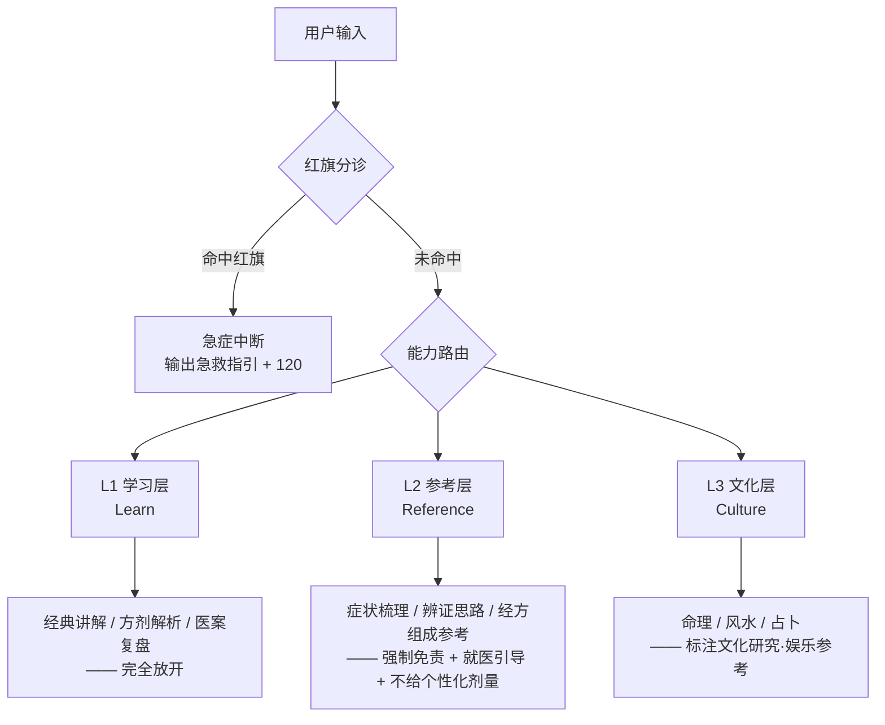
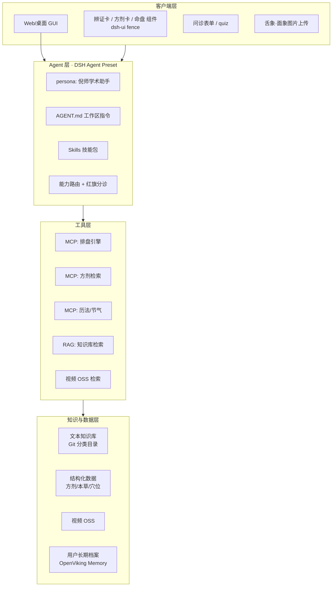
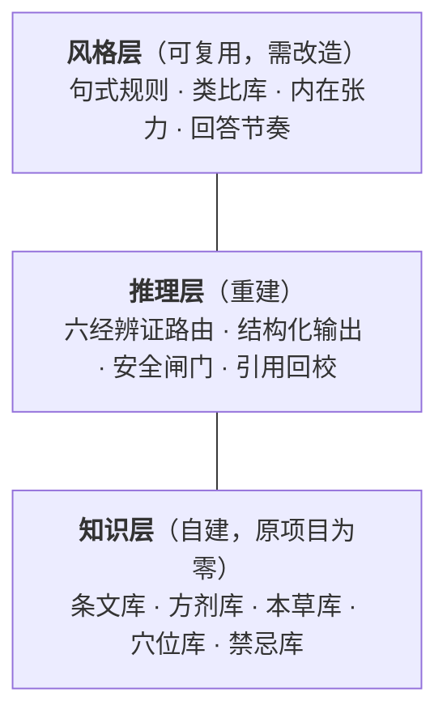

# 倪师 AI（NiShi AI）产品设计书

> 版本：v0.1（设计稿）
> 日期：2025-10
> 状态：待评审
> 技术底座：DeepSeek Harness（DSH / SparkWork）

---

## 0. 一句话定位

**以倪海厦学术思想为知识内核、以 DeepSeek Harness 为工程底座的「中医经典研习 + 传统文化参考」AI 平台**，为用户提供可追溯、有边界、能长期陪伴的对话式服务。

---

## 1. 我们要解决的真实问题

### 1.1 用户侧的三个痛点

| 痛点 | 现状 | 我们的解法 |
|---|---|---|
| **知识散** | 倪师内容分散在汉唐官网、finalhopes 大全集、视频、书籍、讲义里，检索基本靠人肉翻 | 统一知识库 + 语义检索 + 引用溯源 |
| **门槛高** | 文言原文、术语密集、方剂加减逻辑隐晦，普通人读不懂、用不上 | 结构化讲解 + 辨证卡 + 白话对照 |
| **断档** | 看完就忘，复诊无法对比上次状态 | 长期用户档案（体质/证型/调理记录） |

### 1.2 产品的核心张力（必须先承认）

用户想要的是「**诊断、开方**」。但：

- **法律上**：AI 不具备执业医师资质，不得从事诊疗活动；开方属于医疗行为。
- **人格权上**：倪海厦先生已于 2012 年逝世，其姓名、肖像、名誉受《民法典》第 994 条身后人格利益保护。
- **版权上**：汉唐官网文章、大全集视频、出版书籍均有著作权归属。

**设计决策**：我们不回避这个张力，而是把它**产品化**——用「能力闸门 + 溯源 + 分诊」把服务做成**真正合规且更有用**的形态。

> 核心洞察：一个诚实的「经典参考 + 就医引导」产品，比一个假装能开方的产品**留存更高、风险更低**。因为中医的真实价值在「长期调理与认知升级」，而不是「替代医生开一张方子」。

---

## 2. 三层能力闸门（Capability Gate）

这是整个产品的架构基座。每层对应不同的能力、话术、输出结构与合规要求。



### L1 学习层（Learn）— 无风险，全力开放

| 项 | 内容 |
|---|---|
| 典型问法 | 「伤寒论第 35 条什么意思」「桂枝汤的配伍逻辑」「小柴胡汤治什么」 |
| 能力 | 原文精读、白话对照、方剂拆解、医案复盘、学习路径规划、背诵测验 |
| 输出 | 讲义式长文、结构化方剂卡、学习计划 |
| 合规 | 无需免责（属于知识讲解） |

### L2 参考层（Reference）— 高价值，高约束

| 项 | 内容 |
|---|---|
| 典型问法 | 「我最近老是失眠口苦，怎么回事」「我这个情况适合什么方」 |
| 能力 | 十问式结构化问诊、八纲/六经/脏腑辨证**思路演示**、经方**组成与原文**参考 |
| 输出 | 辨证卡、参考方剂卡（含**古籍原文**）、就医建议、生活方式建议 |
| **硬约束** | ① 明确声明「非医疗诊断」② 每次输出固定引导线下就医 ③ **不给个性化剂量**，只给古籍原方比例 ④ 不做「你有 X 病」的确诊式断言 |
| 为什么可行 | 古籍原文与方剂组成属于**公开知识**，讲解它不构成诊疗；个性化剂量才是医疗行为的核心红线 |

> **剂量红线**是 L2 最关键的设计。给「桂枝三两、芍药三两」是引经据典；说「你吃桂枝 9 克」就是开方。产品必须清楚地区分这两者。

### L3 文化层（Culture）— 有趣，但必须去风险化

| 项 | 内容 |
|---|---|
| 典型问法 | 「帮我看看八字」「我家厨房位置好不好」「起一卦」 |
| 能力 | 紫微斗数排盘解读、八字分析、风水格局分析、六爻/梅花易数占卜、易经卦象 |
| 输出 | 命盘图 + 解读、卦象分析、风水建议 |
| **硬约束** | ① 定位标注为「传统文化研究与娱乐参考」② 不对健康/婚姻/投资等重大决策给出确定性结论 ③ 排盘必须由**确定性算法**生成（见 §5.3），LLM 只负责解读 |

---

## 3. 六大对话能力（功能域）

对应你提出的：**诊断、开方、看风水、占卜、算命、学习**。

### 3.1 对话 · 问诊（Consultation）

**倪师风格的结构化问诊**——这是产品的入口体验。

- 借鉴中医「十问歌」：一问寒热二问汗，三问头身四问便，五问饮食六胸腹，七聋八渴俱当辨，九问旧病十问因，再兼服药参机变；妇女尤必问经期，迟速闭崩皆可见。
- 用 **GenUI 交互表单**逐步采集，而非一次性长问卷（降低流失）。
- 支持**多模态补充**：舌苔照片、面色照片（DSH 附件能力原生支持 PNG/JPEG/WebP/GIF）。
- 每次问诊结束，结构化沉淀为「本次记录」，写入用户长期档案。

### 3.2 诊断 · 辨证（Syndrome Differentiation）

输出**辨证卡**，而不是一句结论：

| 板块 | 内容 |
|---|---|
| 主诉归纳 | 用户自述要点提炼 |
| 辨证框架 | 八纲（阴阳表里寒热虚实）/ 六经（太阳阳明少阳太阴少阴厥阴）/ 脏腑 |
| 证型倾向 | 可能证型 + **置信度** + 支持/反对证据 |
| 鉴别要点 | 需排除的相邻证型与鉴别方法 |
| 经典依据 | 《伤寒论》第 X 条、《金匮要略》X 篇原文引用 |
| 就医建议 | 建议就诊科室 + 需向医生说明的要点 |

> 关键：用「**倾向 / 可能性 / 证据**」的语言，而不是「**你是 / 你有**」。这既是合规要求，也是中医辨证本身的诚实表达。

### 3.3 开方 · 经方参考（Formula Reference）

**方剂参考卡**结构：

1. 方名与出处（《伤寒论》桂枝汤）
2. **古籍原方**：组成、原比例、煎服法（原文引用）
3. 方义解析：君臣佐使、配伍逻辑
4. 适用证型与经典条文
5. 加减思路（倪师常用加减）
6. **禁忌与注意事项**（原文中的「不可与」等）
7. 现代参考：是否属于药食同源 / 是否含需医师指导的药材
8. 固定结尾：**剂量与用法必须由执业中医师面诊后确定**

### 3.4 风水（Feng Shui）

- **形家**（形势派）：外部环境、道路水系、建筑形制
- **理气**（理气派）：八宅、玄空飞星
- 输入：房屋坐向、户型图描述/照片、周边环境
- 输出：格局分析 + 调整建议（去风险化措辞）
- 关联倪师「天纪」体系内容

### 3.5 占卜（Divination）

- 六爻（纳甲筮法）、梅花易数、易经卦象
- 起卦方式：时间起卦 / 数字起卦 / 报数起卦（**必须用确定性算法**）
- 输出：卦象图 + 卦辞爻辞（原文引用）+ 象数解读 + **「仅供参考」标注**

### 3.6 算命（Destiny Analysis）

- **紫微斗数**：排盘（十二宫、主星、四化）+ 解读
- **八字**：四柱排盘（干支、藏干、十神、大运流年）+ 解读
- **排盘必须由代码完成**（历法、节气、真太阳时、闰月都是精确计算）

### 3.7 学习（Learning）— 贯穿性能力

- 经典导读与章节地图
- 方剂/本草/穴位**结构化检索与背诵测验**（DSH 的 quiz 组件天然适配）
- 学习路径规划（如：零基础 → 伤寒论 → 经方临床）
- 「倪师视角」问答：基于语料回答「倪师怎么看待 X」

---

## 4. 用户与场景

### 4.1 用户画像

| 画像 | 占比预估 | 核心诉求 | 主用层级 |
|---|---|---|---|
| **中医爱好者 / 自学者** | 40% | 读懂经典、系统学习、考证 | L1 学习 |
| **亚健康调理人群** | 30% | 失眠/脾胃/月经/疲劳等慢性问题 | L2 参考 + L1 学习 |
| **传统文化爱好者** | 20% | 命理、风水、易经 | L3 文化 |
| **中医从业者 / 学生** | 10% | 快速检索条文、方剂对比、医案参考 | L1 + L2 |

### 4.2 核心用户旅程

**旅程 A：亚健康用户的第一次对话**

```
提问「最近总失眠」→ 红旗筛查 → 十问式结构化问诊（GenUI 表单）
→ 舌象照片上传 → 辨证卡（含置信度与鉴别要点）
→ 经方参考卡（古籍原方，不给个性化剂量）
→ 生活方式建议 + 就医引导
→ 沉淀为体质档案 → 7 天后主动回访对比
```

**旅程 B：学习者的经典精读**

```
「我要系统学伤寒论」→ 学习路径规划 → 太阳病篇导读
→ 逐条精读（原文 + 白话 + 方剂关联 + 倪师讲解视频片段）
→ 章节测验（quiz）→ 错题回顾 → 进度追踪
```

**旅程 C：命理爱好者的排盘**

```
「1990年5月3日 早上8点 出生 女」→ 确定性排盘引擎（真太阳时校正）
→ 紫微命盘图 → 十二宫解读 → 与倪师天纪体系对照
→ 「传统文化研究，仅供参考」标注
```

---

## 5. 技术架构（DSH 底座）

### 5.1 分层视图



### 5.2 Agent Preset 设计

DSH 支持自定义 Agent Preset（`$DSH_HOME/.agent-presets/<name>/`），一个 preset 就是一份 Cordis 组合。产品提供 `nihaisha` preset：

| 组成 | 配置 |
|---|---|
| `persona` | 倪师学术助手人格（严谨、引经据典、有边界） |
| `agent-instructions` | 加载 `AGENT.md`（≤64 KiB 预算） |
| `skill-filesystem` | 发现本项目 `.dsh/skills/` 下的技能包 |
| `tool-fs` / `tool-bash` | 读取知识库、运行检索脚本 |
| `tool-skill` | 技能目录与按需加载 |
| `tool-web` | 补充检索（默认 `fetch:false`） |
| 附件 | 舌象/面象图片上传 |
| memory (OpenViking) | 用户长期体质档案 |
| genui | 结构化输出卡片 |

### 5.3 关键工程决策：排盘必须用确定性代码

**这是本项目最重要的技术判断之一。**

紫微斗数与八字排盘依赖：农历转换、节气时刻、真太阳时（经度时差 + 均时差）、闰月、大运起运时间。这些是**精确天文历法计算**。

> **绝不能让 LLM 直接「心算」排盘。** 大模型在历法推算上会生成看似合理但完全错误的结果，而命理产品的用户会逐星核对——错一次就失去全部信任。

方案：封装 **MCP 排盘服务**（TypeScript/Python 实现，基于成熟的农历与历法库），LLM 只调用工具拿结构化命盘，然后负责「解读」。

同理适用于：
- 六爻/梅花起卦（需确定性随机与时间基准）
- 方剂剂量换算（汉制「两」的现代折算存在多种学说，必须标注而非硬算）
- 体质档案的日期推算

### 5.4 RAG 检索策略

| 数据类别 | 检索方式 | 说明 |
|---|---|---|
| 经典原文 | **精确检索优先**（条文号、篇名） | 原文必须逐字准确，不能靠向量近似 |
| 汉唐文章 | 混合检索（BM25 + 向量） | 语义相近但用词不同 |
| 方剂/本草 | **结构化查询** | 按方名、药名、证型精确匹配 |
| 视频 | 元数据检索 + 时间戳跳转 | 视频存 OSS，索引留本地 |
| 讲义/日志 | 混合检索 | |

> **原则**：经典原文永远从结构化数据里**原样取出**，绝不交给模型「复述」——模型复述古文极易篡改字句。

### 5.5 引用与溯源（Trust Layer）

每条实质性结论后附来源标记：

```markdown
桂枝汤证的典型表现是「头痛发热，汗出恶风」。
［来源：《伤寒论》第 13 条 · 原文］
［来源：汉唐文章《…》· 2008-03］
```

DSH 的 `copy` / `code` / `keyvalue` 组件可用于渲染结构化引用块。

---

## 6. 合规与安全设计

### 6.1 红旗症状分诊（最高优先级）

命中以下任一情况，**立即中断正常对话**，输出急救指引，不进入辨证流程：

| 类别 | 症状 |
|---|---|
| 心血管 | 胸痛胸闷压榨感、放射至左臂/下颌、大汗淋漓 |
| 脑血管 | 突发面瘫、单侧肢体无力、言语不清、剧烈头痛 |
| 呼吸 | 严重呼吸困难、口唇发紫、咯血 |
| 消化 | 呕血、黑便、剧烈腹痛板状腹 |
| 神经 | 意识障碍、抽搐、晕厥 |
| 特殊人群 | 孕妇腹痛/出血、婴幼儿高热惊厥 |
| 精神 | 自伤/自杀意念 |

响应模板：先共情 → 明确「这需要立即就医」→ 给出具体行动（拨打 120 / 前往急诊）→ 明确不提供任何辨证或方剂。

### 6.2 合规检查清单

- [ ] 全站固定免责声明（非医疗建议 / 不替代执业医师）
- [ ] L2 每次输出附就医引导
- [ ] L3 每次输出附「传统文化研究，仅供参考」
- [ ] 不做确诊式断言、不给个性化剂量
- [ ] 不冒用倪海厦先生姓名/肖像作为「他本人在回答」的暗示 → 使用「倪海厦学术思想」定位，明确标注为 AI
- [ ] 内容版权梳理与授权（汉唐官网、大全集视频、书籍）
- [ ] 用户数据合规（个人信息保护法：健康数据属敏感个人信息，需单独同意）
- [ ] 未成年人保护策略

### 6.3 AI 身份透明

产品必须在显著位置声明：**这是基于倪海厦先生公开学术内容构建的 AI 助手，不是倪海厦本人，其观点不代表本人意见。**

---

## 7. 版本路线图

### V0.1 — 知识底座与学习层（当前阶段）

- 资源采集与分类入库
- AGENT.md 与 skills 骨架
- L1 学习能力（经典讲解、方剂检索）
- 资源目录与 OSS 方案落地

### V0.2 — 参考层与用户档案

- 十问式结构化问诊（GenUI 表单）
- 辨证卡、方剂参考卡
- 舌象/面象图片上传
- 红旗分诊模块
- 用户长期档案（memory）

### V0.3 — 文化层与确定性排盘

- MCP 排盘服务（紫微、八字、六爻）
- 风水格局分析
- 命盘可视化

### V0.4 — 多专家会诊与个性化

- 多 subagent 并行会诊（经方家 + 针灸家 + 本草家）
- 复诊对比与调理追踪
- 学习进度与测验体系

---

## 8. 成功指标

| 类型 | 指标 | 目标 |
|---|---|---|
| 信任 | 引用可溯源率 | > 95% 实质性结论带来源 |
| 安全 | 红旗分诊召回率 | 100%（漏检为 0） |
| 安全 | 剂量红线违规 | 0 |
| 体验 | 首次对话完成结构化问诊率 | > 60% |
| 留存 | 7 日回访率 | > 35% |
| 内容 | 知识库覆盖率 | 经典五经 + 汉唐文章 ≥ 90% |

---

## 9. 资源复用策略（基于实测调研）

对三个资源做了实测调研后，结论与最初的预期**有重要出入**，直接影响建设方案。

> 详细取证见 [`docs/research/nihaisha-skill-技术分析.md`](../research/nihaisha-skill-技术分析.md)

### 9.1 关键纠偏：`nihaisha-skill` 没有中医能力

最初设想「复用 huoyalong/nihaisha-skill 的技能」。实测结果：

| 项目 | 实测事实 |
|---|---|
| 形态 | Claude Skill 格式的**人格蒸馏包**，非 MCP、非 Agent 框架 |
| 体量 | **8 个 Markdown 文件、64,444 字符、零代码** |
| 能力 | 实测 `方剂库`/`本草库`/`知识库`/`检索`/`风水` 关键词**全部为 0** |
| 真实能力 | **人格化问答 + 风格模拟**（5 心智模型 / 9 决策启发式 / 表达 DNA） |
| `references/` | 是**人物传记调研笔记**（只列方名、无组成剂量），且 `SKILL.md` **0 次引用**，运行时永不加载 |
| License | **无 License** → 不可直接再分发 |
| 安全机制 | **全文 0 次免责声明** |

**一句话**：它提供的是「**怎么说**」，完全没有提供「**说什么**」。

### 9.2 因此：采用三层解耦架构



| 层 | 策略 | 理由 |
|---|---|---|
| **风格层** | ⚠️ 可复用**思路**，**须独立重写文本** | 思想与风格不受版权保护，但逐字复制受版权约束；原仓库无 License |
| **推理层** | 🔨 重建 | 原项目无结构化管线、无引用回校 |
| **知识层** | 🔨 自建（P0，最大缺口 = 最大机会） | 原项目完全没有 |

### 9.3 可直接借鉴的 8 个提示词工程手法

这些是原项目**质量最高的部分**（思想可借鉴，文本须重写）：

1. **第一人称 + 反漂移硬约束** —— 角色被拉走时如何拉回
2. **风格「可执行化」** —— 把风格写成规则和正反例，而非形容词
3. **预置类比库** —— 把「解释能力」做成可检索素材表
4. **负面清单** —— 「绝对不应该出现的话」（⚠️ 但须删掉与安全话术冲突的条目，见 §9.4）
5. **心智模型强制带局限** —— 每个模型必须附「这个模型的局限」
6. **保留内在张力** —— 不抹平矛盾，让产品「有观点」而非「和稀泥」（**最具差异化的部分**）
7. **问题分类路由** —— 事实类 / 框架类 / 混合类分流
8. **一手/二手来源分级标注**

### 9.4 原项目的高危缺陷（必须对冲）

| 缺陷 | 风险 | 我们的对策 |
|---|---|---|
| 「禁用模糊词」+「禁止咨询医师话术」 | 处方级断言 | AGENT.md §4 安全话术原则：**用人设语气说安全的话** |
| 全文 **0 次免责** | 无触发机制 | AGENT.md §8 三层定语速查，强制注入 |
| 高剂量附子（50–100g）作人格素材 | 毒性药致死风险 | 红线 R9：毒性药不给克数 + 本草库增设 `toxicity` 字段 |
| 反对化疗、贬低降糖药 | **可能致用户放弃有效治疗** | 红线 R8：观点可讲，建议不可给 |
| Step 2「必须联网」 | 无工具时诱发编造条文 | 改为「必须检索本地知识库 + 引用回校」；配 `mcp__jingdian__*` |
| 无红旗机制 | 急症漏检 | **已实现**：`src/nhx_triage/`（21 例召回 100%） |
| 无评测集 | 无法回归 | 建黄金评测集（含红旗题、越界题、风格题） |

### 9.5 版权结论

| 内容 | 状态 | 可做什么 |
|---|---|---|
| 《伤寒论》《金匮要略》《神农本草经》《黄帝内经》原文 | **公有领域** | ✅ 可安全使用 |
| `nihaisha-skill` 提示词文本 | 无 License | ⚠️ 不可再分发，须独立重写 |
| 汉唐官网文章 | 需确认 | ⚠️ 联系权利人 |
| 大全集视频 | 需确认 | ⚠️ 优先取授权 |

> **好消息**：中医经典原文属公有领域，**知识层的地基是干净的**。风险集中在倪师个人的文章、视频与讲义上。

---

## 10. 已决策事项与待决策问题

### 10.1 已决策（2025-10）

| # | 问题 | 决策 | 影响 |
|---|---|---|---|
| 1 | 内容授权 | **判定为公开资源，直接使用**；台账状态记为 `主张公开`，保留来源 URL 与下架能力 | 解除采集阻塞 |
| 2 | 视频来源 | 按公开资源处理，**建管理界面统一管理** | 已实现 `src/nhx_media/` |
| 3 | 医师闭环 | **引入**「AI 预问诊 + 执业医师确认」 | 见 [医师闭环设计](02-医师闭环设计.md) |

> 决策的完整记录与证据对照见[来源台账 §2](../02-资源管理/来源台账.md)。
> 台账保留了「决策方立场」与「权利人声明证据」两栏，
> 目的是让决策**可追溯、可复核、可回滚**。

### 10.2 仍需决策

| # | 问题 | 为什么重要 |
|---|---|---|
| 1 | **商业模式** | 订阅 / 按次 / 课程包 / 医师服务分润——直接影响架构与成本模型 |
| 2 | **医师合作模式** | 自建诊所、合作机构、还是医师入驻分润？决定资质路径 |
| 3 | **多用户形态** | DSH 当前偏个人工作台；自建服务层 vs 多 Profile，工作量差异大 |
| 4 | **视频码率策略** | 720p 全量约 494 GB；CDN 流量是大头（1000 次全片播 ≈ ¥9.9 万），需定分发策略 |
| 5 | **上线顺序** | 建议先上 L1 学习层（最快、风险最低），但需确认节奏 |

### 10.3 一个必须注意的政策约束

**互联网诊疗不得首诊**。这直接限定医师闭环的定位：

| 场景 | 可否 | 做法 |
|---|---|---|
| 首次不适来咨询 | ❌ 不得诊疗 | 只做**就医引导**（推荐线下），不给诊疗意见 |
| 已确诊的慢性病复诊 | ✅ 可 | 医师闭环正式生效 |
| 健康管理与调理咨询 | ✅ 可 | AI 预问诊 + 医师确认 |

产品文案与流程设计必须体现这个区分，否则存在合规风险。
