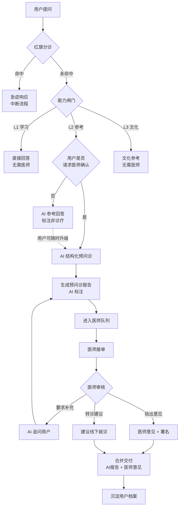

# 「AI 预问诊 + 执业医师确认」闭环设计

> 配套文档：[产品设计书](01-产品设计书.md) ｜ [AGENT.md](../../AGENT.md) ｜ [技术架构](../03-技术架构/01-技术架构设计.md)
> 状态：设计完成，状态机已实现（`src/nhx_clinic/`）

---

## 0. 为什么这是产品的护城河，而不只是合规成本

第一版设计书里，AI 不能开方是**约束**。引入医师闭环后，它变成**优势**：

| 纯 AI 产品 | AI + 医师闭环 |
|---|---|
| 法律上不能诊断开方 | 可以（医师负责） |
| 用户得到「参考」，不放心 | 用户得到医师确认，可信 |
| 责任模糊 | 责任清晰：医师署名 |
| 医师被视为成本 | 医师是供给侧的放大器 |
| 只能做知识问答 | 可以做完整健康服务闭环 |

**核心洞察**：AI 的价值不是替代医师，而是**把医师单位时间的产能放大**——
AI 把 15 分钟的问诊压缩成 3 分钟的结构化阅读。医师愿意合作，用户得到确定性，
平台获得合规的诊疗能力。三方共赢。

---

## 1. 端到端流程



### 1.1 关键设计：交付物分两段，视觉必须区分

| 部分 | 生成者 | 标注 | 法律性质 |
|---|---|---|---|
| **预问诊报告** | AI | 「AI 整理，未经医师确认」 | 信息整理，非诊疗 |
| **医师意见** | 执业医师 | 「医师署名 + 执业证编号」 | 诊疗意见，医师负责 |

**两者必须在视觉上不可混淆**（不同色块、不同署名区、明确的分隔标题）。
这是产品最重要的合规设计——用户必须清楚知道哪句话是谁说的。

### 1.2 体验设计：异步但不等

医师确认是异步的（分钟~小时级），但用户不该干等：

```
t+0s    用户提交
t+2s    AI 预问诊报告立即可得（含经典参考，标注非诊疗）
t+5s    「已进入医师队列，预计 30 分钟内回复」+ 排队位置
t+30min 推送通知：医师意见已送达
```

**预问诊报告本身就有价值**（结构化整理 + 经典依据），所以等待期间用户不空手。

---

## 2. 责任边界（法律核心）

| 事项 | AI | 医师 | 平台 |
|---|---|---|---|
| 信息采集 | ✅ 结构化提问 | — | — |
| 经典检索与呈现 | ✅ 原文引用 | — | — |
| 辨证判断 | ❌ 只给「倾向 + 证据」供参考 | ✅ 最终判断 | — |
| 处方 | ❌ **绝不出具** | ✅ **唯一处方主体** | — |
| 剂量 | ❌ 只引古籍原文比例 | ✅ 决定现代剂量 | — |
| 责任 | 不承担诊疗责任 | ✅ 承担诊疗责任 | 资质审核、留痕、合规 |

**工程约束**：

1. AI 生成的报告在数据里带 `generated_by: "ai"` 与 `review_status: "unreviewed"`。
2. 医师意见带 `physician_id`、`license_no`、`signed_at`。
3. 用户界面**禁止**把未确认的 AI 内容呈现为「诊疗意见」。
4. 全部留痕，可按医师、按时间审计。

---

## 3. 预问诊报告结构

AI 产出的是**结构化信息**，不是诊断结论。

```json
{
  "consultation_id": "c-20251011-0001",
  "generated_by": "ai",
  "review_status": "unreviewed",
  "chief_complaint": "入睡困难 2 个月，伴口苦、易怒",
  "history": {
    "ten_questions": {
      "寒热": "手足心热，夜间尤甚",
      "汗": "入睡后盗汗",
      "头身": "偶有头晕",
      "二便": "大便偏干，小便正常",
      "饮食": "食欲尚可，喜冷饮",
      "胸腹": "胁肋偶有胀感",
      "耳目": "口苦，无耳鸣",
      "渴": "口干欲饮",
      "旧病": "无重大既往史",
      "病因": "工作压力大，长期熬夜"
    },
    "tongue_image_ref": "att-xxxx",
    "pulse_self_report": null
  },
  "reference_findings": [
    {
      "syndrome_inclination": "少阳枢机不利",
      "confidence": 0.6,
      "supporting": ["口苦", "胁肋胀", "易怒"],
      "against": ["无往来寒热", "无咽干目眩"],
      "classic_ref": "《伤寒论》第 96 条"
    }
  ],
  "differentials": ["肝火上炎", "心肾不交"],
  "classic_formulas_for_reference": [
    { "name": "小柴胡汤", "source": "伤寒论 96", "note": "仅列原方组成与原文，不含剂量建议" }
  ],
  "flags_for_physician": [
    "需确认是否需线下脉诊",
    "长期熬夜，建议评估生活方式干预"
  ],
  "disclaimer": "本报告为 AI 整理的信息与经典参考，未经执业医师确认，不构成诊疗意见。"
}
```

**关键设计**：

- `flags_for_physician` —— AI 主动标注「我不确定、需要医师判断的地方」。
  这一字段让医师的阅读从「全面审阅」变成「重点确认」，是产能放大的核心。
- `confidence` 是**倾向权重**，不是概率。
- 古籍原文**原样引用**（R1），不含现代剂量（R2）。

---

## 4. 状态机

```
                    ┌──────────┐
     用户请求医师  → │ pending  │ 已入队，等待接单
                    └────┬─────┘
                         │ 医师接单
                    ┌────▼─────┐
                    │ assigned │ 已指派
                    └────┬─────┘
           ┌─────────────┼─────────────┐
    要求补充资料      给出意见       建议线下就诊
           │             │             │
    ┌──────▼──────┐ ┌────▼─────┐ ┌────▼──────┐
    │ needs_more  │ │ reviewed │ │ referred  │
    └──────┬──────┘ └────┬─────┘ └────┬──────┘
           │ AI追问补全   │            │
           └──────────────┴────────────┴──→ delivered（已交付）
```

| 状态 | 含义 | 谁可以触发 |
|---|---|---|
| `pending` | 已入队，等待医师接单 | 用户 / AI |
| `assigned` | 已指派给某位医师 | 医师 |
| `needs_more` | 医师要求补充资料 | 医师 |
| `reviewed` | 医师已出具意见 | 医师 |
| `referred` | 建议线下就诊（不开方） | 医师 |
| `delivered` | 已交付用户 | 系统 |
| `cancelled` | 用户取消或超时 | 用户 / 系统 |

**不变量（代码强制）**：

1. AI 不能把自己生成的报告置为 `reviewed`。
2. `reviewed` / `referred` 必须带 `physician_id` 与 `license_no`。
3. 只有 `reviewed` / `referred` 可以进入 `delivered`。
4. 任何状态变更都留下审计记录。

---

## 5. 医师侧体验（供给侧的关键）

医师愿意用，闭环才转得起来。给医师的价值是**省时间**：

| 医师看到 | 设计意图 |
|---|---|
| 一屏摘要（主诉 + 关键证据 + 倾向） | 3 分钟上手，而非 15 分钟问诊 |
| 「需要您判断的问题」置顶 | `flags_for_physician` 直接变成待办 |
| 古籍原文已在侧栏 | 不用自己查书 |
| 一键「要求补充」 | 让 AI 去追问，不占用医师时间 |
| 一键「建议线下就诊」 | 复杂病例快速分流 |
| 署名意见模板 | 减少打字，保证合规字段齐全 |

**产能模型**：若 AI 把单例医师时间从 15 分钟压到 5 分钟，同样人力可服务 3 倍用户。
这是整个商业模式成立的算术基础。

---

## 6. 合规要求（上线前置）

| # | 要求 | 说明 |
|---|---|---|
| 1 | **互联网诊疗资质** | 依《互联网诊疗管理办法》；需持《医疗机构执业许可证》 |
| 2 | **医师实名与资质核验** | 执业医师资格证 + 执业证，登记并在平台公示 |
| 3 | **诊疗范围限制** | 互联网诊疗**不得用于首诊**（政策要求）；仅限常见病、慢性病复诊 |
| 4 | **处方管理** | 处方须医师电子签名；严禁 AI 生成处方 |
| 5 | **全程留痕** | 问诊记录、医师意见、处方保存≥规定年限 |
| 6 | **AI 身份标识** | 用户必须清楚知道哪部分是 AI、哪部分是医师 |
| 7 | **敏感信息保护** | 健康数据单独同意、加密、最小必要（PIPL） |
| 8 | **不得夸大宣传** | 产品宣传不得暗示 AI 可替代医师 |

> **注意第 3 条**：互联网诊疗**不得首诊**，这直接影响产品定位——
> 医师闭环必须定位为「**复诊与健康管理**」，而不是「初次看病」。
> 首诊场景只能做**就医引导**（推荐线下），这也正是 AGENT.md 现有设计的姿态。

---

## 7. 与现有设计的衔接

| 已有设计 | 闭环中的角色 |
|---|---|
| 红旗分诊（`src/nhx_triage/`） | 闭环第一道闸门，命中即中断（不进入医师队列） |
| 三层能力闸门 | L1 免医师；L2 可选医师；L3 不涉医师 |
| 辨证卡 | 变成预问诊报告的 `reference_findings` 段 |
| 方剂参考卡 | 变成 `classic_formulas_for_reference`，仍不给剂量（R2） |
| 用户长期档案 | 记录历次预问诊 + 医师意见，支持复诊对比 |
| 溯源机制 | 医师意见同样署名可溯源 |

**R2/R8/R9 在闭环中依然生效**：AI 部分照旧不给剂量、不否定规范治疗、毒性药不给克数。
医师的部分由医师的执业规范约束，平台不做技术限制但要留痕。

---

## 8. 实现状态

| 组件 | 状态 | 位置 |
|---|---|---|
| 状态机 + 数据层 | ✅ 已实现 | `src/nhx_clinic/review.py` |
| 状态机测试（含不变量） | ✅ 已实现 | `src/nhx_clinic/test_review.py` |
| 预问诊报告 Schema | 📋 本文档 §3 定义 | — |
| 医师侧界面 | ⏳ 待实现 | — |
| 用户侧交付界面 | ⏳ 待实现 | — |
| 资质与留痕体系 | ⏳ 待实现（业务前置） | — |

---

## 9. 上线路径建议

| 阶段 | 内容 | 前置 |
|---|---|---|
| **P0** | AI 预问诊 + 报告生成（**医生栏位留空**） | 无 |
| **P1** | 医师侧只读界面，内部试用，不对外 | 招募 1–2 位合作医师 |
| **P2** | 小范围对外，医师确认后交付 | 医疗机构资质 |
| **P3** | 规模化，产能与质量指标运营 | 医师团队 + 质检流程 |

> **关键建议**：P0 不需要任何资质即可上线，且已经能交付「AI 预问诊报告」这一完整价值。
> 医师闭环可以在**已有用户基础与真实数据**之后再加，风险更低、说服力更强。
