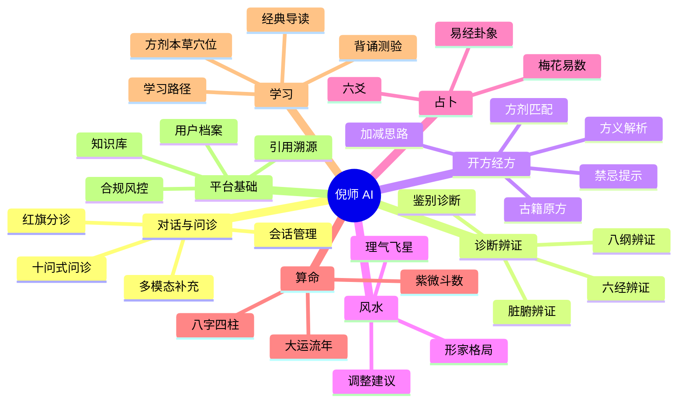

# 功能梳理与优先级清单

> 配套文档：[产品设计书](../00-产品设计/01-产品设计书.md)
> 优先级：**P0** = V0.1~V0.2 必须有 ｜ **P1** = V0.3 应有 ｜ **P2** = 后续迭代

---

## 0. 功能地图总览



---

## 1. 对话与问诊域（Consultation）

| ID | 功能 | 层 | 优先级 | 说明 | 验收标准 |
|---|---|---|---|---|---|
| **C-01** | 红旗症状分诊 | 全局 | **P0** | 输入即筛查急症信号，命中则中断正常流程 | 20 条红旗用例召回 100%，漏检 0 |
| **C-02** | 十问式结构化问诊 | L2 | **P0** | GenUI 分组表单，按十问歌逐步采集 | 可完成一次完整问诊并落盘结构化记录 |
| **C-03** | 自由对话入口 | L1 | **P0** | 非表单式的自然语言提问 | 任意问题能正确路由到能力层 |
| **C-04** | 舌象/面象图片上传 | L2 | **P0** | 复用 DSH 附件能力（PNG/JPEG/WebP/GIF） | 上传图片进入模型上下文并可被引用 |
| **C-05** | 会话历史与续接 | 全局 | **P0** | 会话持久化、恢复、分叉 | 关闭后重开可继续 |
| **C-06** | 能力层自动路由 | 全局 | **P0** | 判断问题属于 L1/L2/L3 | 抽样 50 题路由准确率 > 90% |
| **C-07** | 多轮追问澄清 | L2 | **P1** | 信息不足时主动追问而非硬答 | 缺主症时必追问 |
| **C-08** | 语音输入 | 全局 | **P2** | 语音转文字问诊 | — |
| **C-09** | 家人多档案切换 | L2 | **P2** | 一个账号管理多位家人 | — |

### C-01 红旗分诊（最高优先级功能）

命中即中断，输出急救指引，**不进入辨证**。

| 类别 | 触发信号 |
|---|---|
| 心血管 | 压榨性胸痛、放射至左臂/下颌、濒死感、大汗 |
| 脑血管 | 突发面瘫、单侧肢体无力、言语不清、剧烈头痛 |
| 呼吸 | 严重呼吸困难、口唇发紫、咯血 |
| 消化 | 呕血、黑便、板状腹、剧烈腹痛 |
| 神经 | 意识障碍、抽搐、晕厥 |
| 特殊人群 | 孕妇腹痛/出血、婴幼儿高热惊厥 |
| 精神 | 自伤/自杀意念 |

输出模板（固定）：共情 → 明确「需立即就医」→ 具体行动（拨打 120 / 急诊）→ 声明不提供辨证与方剂。

---

## 2. 诊断辨证域（Differentiation）

| ID | 功能 | 层 | 优先级 | 说明 | 验收标准 |
|---|---|---|---|---|---|
| **D-01** | 辨证卡输出 | L2 | **P0** | 结构化卡片，非自然语言结论 | 卡片含主诉/框架/证型/置信度/依据/就医建议 |
| **D-02** | 八纲辨证 | L2 | **P0** | 阴阳表里寒热虚实 | 每纲给出支持证据 |
| **D-03** | 六经辨证 | L2 | **P0** | 太阳阳明少阳太阴少阴厥阴 | 关联《伤寒论》条文号 |
| **D-04** | 脏腑辨证 | L2 | **P1** | 五脏六腑定位 | — |
| **D-05** | 置信度与证据分层 | L2 | **P0** | 支持证据 / 反对证据 / 待确认 | 明确区分三栏 |
| **D-06** | 鉴别要点 | L2 | **P0** | 需排除的相邻证型 | 至少给出 1 组鉴别 |
| **D-07** | 经典条文关联 | L2 | **P0** | 自动挂接相关条文 | 条文号与原文准确（逐字） |
| **D-08** | 就医建议 | L2 | **P0** | 建议科室 + 需向医生说明的要点 | 每次输出必带 |
| **D-09** | 体质辨识 | L2 | **P1** | 九种体质分类 | — |
| **D-10** | 辨证对比视图 | L2 | **P2** | 本次 vs 上次对照 | — |

> **语言红线**：使用「倾向 / 可能性 / 支持证据」，禁止「你是 / 你有 X 病」的确诊式断言。

---

## 3. 开方经方域（Formula）

| ID | 功能 | 层 | 优先级 | 说明 | 验收标准 |
|---|---|---|---|---|---|
| **F-01** | 方剂参考卡 | L2 | **P0** | 八段式结构（见下） | 八段齐全 |
| **F-02** | 古籍原方引用 | L2 | **P0** | 组成/比例/煎服法**原样取自结构化库** | 与古籍逐字一致 |
| **F-03** | 方义解析 | L1 | **P0** | 君臣佐使、配伍逻辑 | — |
| **F-04** | 适用证型与条文 | L1 | **P0** | 关联条文号 | — |
| **F-05** | 加减思路 | L1 | **P1** | 倪师常用加减 | 标注「出自古籍」或「后世经验」 |
| **F-06** | 禁忌与注意事项 | L2 | **P0** | 原文「不可与」、妊娠禁忌、十八反十九畏 | 命中禁忌必提示 |
| **F-07** | **剂量红线** | L2 | **P0** | 只给古籍原方比例，不给个性化现代剂量 | 违规输出 0 例 |
| **F-08** | 药食同源标识 | L2 | **P1** | 标记是否属药食同源 | — |
| **F-09** | 方剂对比 | L1 | **P1** | 类方对比（桂枝汤 vs 麻黄汤） | — |
| **F-10** | 现代药理提示 | L1 | **P2** | 药物相互作用提示 | — |

### F-01 方剂参考卡结构

```
1. 方名与出处
2. 古籍原方（组成 · 原比例 · 煎服法）   ← 原样引用，非模型复述
3. 方义解析（君臣佐使）
4. 适用证型与经典条文
5. 加减思路
6. 禁忌与注意事项
7. 现代参考（药食同源 / 需医师指导药材）
8. 固定结尾：剂量与用法须由执业中医师面诊后确定
```

---

## 4. 风水域（Feng Shui）

| ID | 功能 | 层 | 优先级 | 说明 |
|---|---|---|---|---|
| **S-01** | 房屋基本信息采集 | L3 | **P1** | 坐向、建造年份、层数、户型 |
| **S-02** | 形家格局分析 | L3 | **P1** | 外部环境、道路水系、建筑形制 |
| **S-03** | 理气飞星排盘 | L3 | **P1** | 八宅 / 玄空飞星（**确定性计算**） |
| **S-04** | 调整建议 | L3 | **P1** | 去风险化措辞 |
| **S-05** | 户型图/照片解读 | L3 | **P2** | 图片上传分析 |
| **S-06** | 倪师天纪内容对照 | L3 | **P2** | 关联讲解内容 |

---

## 5. 占卜域（Divination）

| ID | 功能 | 层 | 优先级 | 说明 |
|---|---|---|---|---|
| **Z-01** | 起卦引擎 | L3 | **P1** | 时间/数字/报数起卦，**确定性算法** |
| **Z-02** | 六爻纳甲 | L3 | **P1** | 装卦、六亲、六神、世应 |
| **Z-03** | 梅花易数 | L3 | **P1** | 体用、互变卦 |
| **Z-04** | 卦辞爻辞引用 | L3 | **P1** | 《易经》原文逐字引用 |
| **Z-05** | 卦象可视化 | L3 | **P2** | 六爻卦象图 |
| **Z-06** | 占卜记录与复盘 | L3 | **P2** | 事后验证追踪 |

---

## 6. 算命域（Destiny）

| ID | 功能 | 层 | 优先级 | 说明 |
|---|---|---|---|---|
| **M-01** | **确定性排盘引擎（MCP）** | L3 | **P1** | 农历/节气/真太阳时，**禁止 LLM 心算** |
| **M-02** | 紫微斗数排盘 | L3 | **P1** | 十二宫、主星、四化、大限 |
| **M-03** | 八字四柱排盘 | L3 | **P1** | 干支、藏干、十神、大运 |
| **M-04** | 命盘可视化 | L3 | **P1** | 十二宫盘 / 四柱盘 |
| **M-05** | 星曜解读 | L3 | **P1** | 与倪师天纪体系对照 |
| **M-06** | 流年流月 | L3 | **P2** | 流年运势 |
| **M-07** | 合盘 | L3 | **P2** | 双人合盘 |

> **工程红线**：M-01 必须是独立可测试的确定性模块，带单元测试用例（已知生辰 → 已知命盘）。

---

## 7. 学习域（Learning）

| ID | 功能 | 层 | 优先级 | 说明 |
|---|---|---|---|---|
| **L-01** | 经典原文检索 | L1 | **P0** | 按条文号/篇名/关键词精确检索 |
| **L-02** | 原文逐条精读 | L1 | **P0** | 原文 + 白话 + 方剂关联 |
| **L-03** | 方剂检索 | L1 | **P0** | 按方名/药名/证型 |
| **L-04** | 本草检索 | L1 | **P0** | 按药名/性味/归经/功效 |
| **L-05** | 穴位检索 | L1 | **P1** | 按穴名/经络/主治 |
| **L-06** | 学习路径规划 | L1 | **P1** | 零基础 → 伤寒论 → 临床 |
| **L-07** | 背诵测验（quiz） | L1 | **P1** | 复用 DSH quiz 组件 |
| **L-08** | 学习进度追踪 | L1 | **P1** | 章节完成度 |
| **L-09** | 错题回顾 | L1 | **P2** | — |
| **L-10** | 视频关联跳转 | L1 | **P1** | 讲义段落 ↔ 视频时间戳 |
| **L-11** | 「倪师视角」问答 | L1 | **P1** | 基于语料回答「倪师怎么看 X」 |
| **L-12** | 医案复盘 | L1 | **P1** | 结构化医案解析 |

---

## 8. 平台基础域（Platform）

| ID | 功能 | 优先级 | 说明 |
|---|---|---|---|
| **P-01** | 知识库构建与入库 | **P0** | 书籍/日志/经方分类存储 |
| **P-02** | 结构化数据表 | **P0** | 方剂/本草/穴位/症状映射 |
| **P-03** | 引用溯源渲染 | **P0** | 每条结论附来源标记 |
| **P-04** | 视频 OSS 存储与索引 | **P0** | 视频上 OSS，索引留本地 |
| **P-05** | 用户长期档案 | **P0** | 体质/证型/调理记录（memory） |
| **P-06** | 合规声明与免责 | **P0** | 全站 + 分层 |
| **P-07** | AI 身份透明声明 | **P0** | 明确非倪海厦本人 |
| **P-08** | Agent Preset 封装 | **P0** | `nihaisha` preset |
| **P-09** | Skills 技能包 | **P0** | 按能力域拆分 |
| **P-10** | MCP 服务（排盘/检索） | **P1** | 确定性计算外置 |
| **P-11** | 多专家会诊（subagent） | **P1** | 并行会诊再汇总 |
| **P-12** | 敏感数据合规 | **P0** | 健康数据单独同意（PIPL） |
| **P-13** | 多租户 / 账号体系 | **P1** | 面向「为用户提供服务」 |
| **P-14** | 用量与成本统计 | **P1** | — |
| **P-15** | 内容审核与日志 | **P1** | 合规留痕 |

---

## 9. 优先级汇总

### P0 — 最小可用闭环（V0.1 ~ V0.2）

```
安全底线：C-01 红旗分诊 · F-07 剂量红线 · P-06 合规声明 · P-07 AI 身份透明
知识底座：P-01 知识库 · P-02 结构化数据 · P-04 视频OSS · L-01~L-04 检索
核心体验：C-02 十问问诊 · C-03 对话 · C-06 能力路由 · C-04 图片上传
输出结构：D-01 辨证卡 · F-01 方剂卡 · P-03 引用溯源
长期价值：P-05 用户档案
工程基础：P-08 preset · P-09 skills
```

### P1 — 完整体验（V0.3 ~ V0.4）

```
M-01 排盘引擎 · M-02 紫微 · M-03 八字 · M-04 命盘可视化
S-02 形家 · S-03 飞星 · Z-01~Z-04 占卜
D-04 脏腑辨证 · D-09 体质辨识
F-05 加减 · F-08 药食同源 · L-05~L-08 · L-10~L-12
P-10 MCP · P-11 会诊 · P-13 多租户 · P-14 成本 · P-15 审核
```

### P2 — 增强与差异化

```
C-08 语音 · C-09 多档案 · D-10 辨证对比
S-05 户型图 · S-06 天纪对照 · Z-05 卦象图 · Z-06 占卜复盘
M-06 流年 · M-07 合盘 · F-10 药理交互 · L-09 错题
```

---

## 10. 需求 → 交付物对照

| 你的原始需求 | 对应功能 ID | 落在哪一层 |
|---|---|---|
| 界面用户可以与倪师 AI 对话 | C-03, C-05, P-08 | L1/L2/L3 全层 |
| 帮助用户**诊断** | C-02, D-01~D-08 | L2 参考层 |
| 帮助用户**开方** | F-01~F-09 | L2 参考层（剂量红线） |
| 帮助用户**看风水** | S-01~S-06 | L3 文化层 |
| 帮助用户**占卜** | Z-01~Z-06 | L3 文化层 |
| 帮助用户**算命** | M-01~M-07 | L3 文化层 |
| 帮助用户**学习** | L-01~L-12 | L1 学习层 |
| 资源管理（小文件分类） | P-01, P-02 | 知识层 |
| 视频存 OSS | P-04 | 知识层 |
| DSH 技术底座 | P-08~P-11 | Agent 层 |
