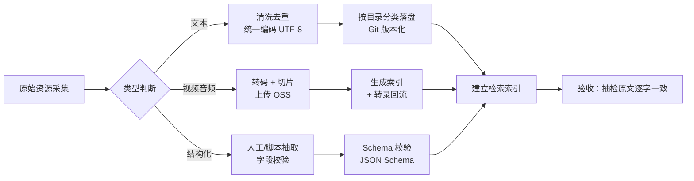

# 资源分类与存储方案

> 配套文档：[产品设计书](../00-产品设计/01-产品设计书.md) ｜ [技术架构](../03-技术架构/01-技术架构设计.md)
> 原始站点调研见 [`docs/research/`](../research/)

---

## 1. 设计目标与判据

一条总原则：**小文件入库（Git），大文件上云（OSS），中间只放索引。**

理由：

| 类型 | 特征 | 存法 | 判据 |
|---|---|---|---|
| 书籍、文章、日志、经方 | 文本、体积小、需 diff 与追溯 | **Git 仓库分类目录** | 能 review 每一次改动 |
| 结构化数据（方剂/本草/穴位） | 需精确查询、字段稳定 | **JSON/YAML（+ 后续 SQLite）** | 能按字段精确检索 |
| 讲义转录、字幕 | 文本、可检索、体积中等 | **Git（JSON）** | 视频内容**知识化**的载体 |
| 视频、音频 | GB 级、需 CDN 分发 | **对象存储 OSS** | 按流量计费，不进 Git |
| 向量索引 | 可重建、体积大 | **本地/服务端向量库** | 可随时重建，不入 Git |

> **Git 的红线**：单文件 > 50 MB、仓库 > 1 GB 会显著拖慢克隆与检索。视频一律不入 Git。

> **例外与落地**：`book/` 下 18 个扫描 PDF（595.8 MB）走 **Git LFS**，
> OCR 全文 HTML 与 `.backup/` 副本不入库。决策过程、体积实测与克隆须知见
> [大文件入库方案](大文件入库方案.md)。

---

## 2. 目录树（已落地）

```
knowledge/                                   # 文本知识库（Git 版本化）
├── 01-人纪-中医经典/
│   ├── 01-针灸大成/
│   │   ├── 原文/                            # ★ 古籍原文（公有领域）
│   │   └── 讲义/                            # ⚠️ 课程转录稿（非原文！）
│   ├── 02-黄帝内经/{原文,讲义}/
│   ├── 03-神农本草经/{原文,讲义}/
│   ├── 04-伤寒论/{原文,讲义}/
│   └── 05-金匮要略/{原文,讲义}/
├── 02-天纪-术数/                             # 倪师「天纪」体系
│   ├── 01-易经/
│   ├── 02-紫微斗数/
│   ├── 03-风水地理/
│   └── 04-占卜/
├── 03-汉唐文章/                              # 汉唐官网文章
│   ├── 01-医案/
│   ├── 02-论文/
│   └── 03-时评/                              # ⚠️ 含大量论战内容，见 §7
├── 04-经方方剂/                              # 经方原文与讲解
├── 05-倪师日志讲义/                          # 日志、讲义、课程转录
└── 06-结构化数据/                            # ★ 供精确查询，非供阅读
    ├── 方剂库/
    ├── 本草库/
    ├── 穴位库/
    ├── 症状-证型映射/
    └── 命理规则/

media/                                       # 媒体「索引」（本体在 OSS）
├── 视频索引/
└── 音频索引/

docs/                                        # 设计与研究文档
├── 00-产品设计/
├── 01-功能梳理/
├── 02-资源管理/
├── 03-技术架构/
└── research/

.dsh/skills/                                 # DSH 技能包（热加载）
src/                                         # 应用与 MCP 服务源码
```

### 🔴 原文与转录稿必须物理分离

**这是实测调研得出的一条重要纠正。**

原始站点（finalhopes.com）上标注为「人纪五大经典」的内容，
实测是**课程录音的人工转录稿（课堂讲解实录）**，**不是古籍原文**
——以《伤寒论》为例，其内容与宋本《伤寒论》条文**并不逐字对应**。

因此 `01-人纪-中医经典/` 下必须分 `原文/` 与 `讲义/` 两个子目录：

| 目录 | 内容 | 可否作为「原文原样」（AGENT.md R1）取数源 |
|---|---|---|
| `原文/` | 古籍原文（公有领域版本） | ✅ **是唯一取数源** |
| `讲义/` | 课程转录稿（倪师讲解） | ❌ **绝对不可**，只能作为「倪师观点」引用 |

两者在引用时也必须用**不同的来源标记**区分：

```
［来源：《伤寒论》第 13 条 · 原文］          ← 取自 原文/
［来源：倪师人纪·伤寒论讲义 第 N 讲］         ← 取自 讲义/
```

> 混淆这两者会直接违反 R1，并让用户以为课堂口语就是经典原文——这是对倪师学术的不尊重，
> 也是对用户的误导。**目录结构是这条红线的物理保障。**

### 内容特征实测（影响入库脚本设计）

| 维度 | 实测结果 | 对入库的影响 |
|---|---|---|
| **编码** | hantang 为 `charset=big5` | 必须 Big5 → UTF-8 转换；**保留繁体原文**，简体检索副本另存 |
| **HTML 结构** | 正文为无 `<h1>` 的纯 `<p>` 流（如 `flu1.htm`：7,425 字 / 0 图 / 0 表） | **无标题层级可依赖**，需按内容切分；结构简单 → 去标签脚本易写 |
| **RAG 适配度** | 正文干净、段落规整 | ✅ **适配度高**，清洗成本低 |
| **体量** | `ch_Articles/` 约 3,580 项 / 160.2 MB（其中 jpg 占 122.7 MB，htm 仅 20.6 MB） | **正文文本仅 20.6 MB**，远低于 Git 红线；图片不入库 |
| **媒体** | **全站无自托管音视频**（仅 19 条 YouTube 外链） | 视频 OSS 方案**阻塞于合法源**，非技术问题 |
| **目录可枚举** | 站点为 Apache 开放目录列表 | 体量可**精确统计**，无需估算 |
| **转录稿单页** | 极大（内经 57 万字、金匮 45.9 万字） | 入库前**必须按章节切分**，否则单文件超检索上限 |

> **以实测为准，不以站方声明为准。** 调研发现**两处集数声明与实际不符**
> （针灸称 78 集 / 实测 63 条；内经称 75 集 / 实测 80 条）。
> 因此媒体索引的「集数、系列名」必须**逐条实测核对**后再写入 `media/`。


### 为什么按「人纪 / 天纪」而不是按「书籍 / 视频」分

倪师的学术体系天然分两层：**人纪**（中医，可服务健康）与**天纪**（术数，文化参考）。
这个分法直接对应产品的 **L1/L2 层** 与 **L3 层**，因此目录结构 = 能力路由结构，一处分类两处受益。

---

## 3. 结构化数据规范

结构化数据是「原文原样」红线（AGENT.md §4 R1）的**物理保障**——原文存在字段里，模型只能取出，不能复述。

### 3.1 方剂库 `knowledge/06-结构化数据/方剂库/<方名>.json`

```json
{
  "id": "guizhi-tang",
  "name": "桂枝汤",
  "aliases": ["阳旦汤"],
  "source": { "book": "伤寒论", "article_no": 12, "original_text": "太阳中风，阳浮而阴弱…桂枝汤主之。" },
  "composition": [
    { "herb": "桂枝", "original_amount": "三两", "role": "君" },
    { "herb": "芍药", "original_amount": "三两", "role": "臣" },
    { "herb": "甘草", "original_amount": "二两，炙", "role": "佐" },
    { "herb": "生姜", "original_amount": "三两，切", "role": "佐" },
    { "herb": "大枣", "original_amount": "十二枚，擘", "role": "使" }
  ],
  "preparation": "上五味，㕮咀三味，以水七升，微火煮取三升，去滓，适寒温，服一升。",
  "indications": ["太阳中风", "营卫不和"],
  "contraindications": ["表实无汗者"],
  "modifications": [
    { "name": "桂枝加葛根汤", "change": "加葛根四两", "origin": "古籍" },
    { "name": "桂枝加厚朴杏子汤", "change": "加厚朴二两、杏仁五十枚", "origin": "古籍" }
  ],
  "six_channel": "太阳",
  "eight_principles": { "yin_yang": "阳", "exterior_interior": "表", "cold_heat": "寒", "deficiency_excess": "虚" }
}
```

> **注意**：`original_amount` 字段存的是**古籍原文的剂量**（三两），不是现代克数。
> 这是产品剂量红线在数据结构上的体现——数据结构本身就不提供现代剂量。

### 3.2 本草库 `knowledge/06-结构化数据/本草库/<药名>.json`

```json
{
  "id": "fuzi",
  "name": "附子",
  "source": { "book": "神农本草经", "grade": "下品", "license_status": "公有领域" },
  "nature_flavor": { "nature": "大热", "flavor": "辛甘" },
  "meridians": ["心", "肾", "脾"],
  "effects": ["回阳救逆", "补火助阳", "散寒止痛"],
  "original_text": "附子，味辛温。主风寒咳逆邪气，温中，金创，破症坚积聚血瘕……",
  "contraindications": ["阴虚阳亢", "孕妇禁用", "不宜与半夏、瓜蒌、贝母、白蔹、白及同用"],

  "toxicity": {
    "level": "大毒",
    "toxic_components": ["乌头碱", "新乌头碱", "次乌头碱"],
    "risk": "治疗窗极窄，超量可致致命性心律失常、呼吸抑制。乌头碱口服 0.2mg 即可中毒，2–4mg 可致死。",
    "requires_physician": true,
    "must_must_decotion": "必须炮制后使用，且需先煎 1–2 小时至口尝无麻感",
    "dosage_withheld": true,
    "note": "本库不提供任何现代克数建议。剂量必须由执业中医师根据炮制品规格、先煎时长与患者体质决定。"
  },

  "interactions": {
    "eighteen_clashes": ["半夏", "瓜蒌", "贝母", "白蔹", "白及"],
    "nineteen_incompatibilities": []
  }
}
```

> **🔴 毒性药字段是硬闸门（AGENT.md 红线 R9）。**
> `toxicity` 对象对附子、麻黄、细辛、乌头、马钱子、巴豆、甘遂、大戟、芫花、水蛭等
> 窄治疗窗药材**必填**。其中：
>
> - `dosage_withheld: true` —— 数据结构层面**不提供**克数，模型无从给出。
> - `requires_physician: true` —— 输出方剂卡时强制附加「须医师掌握」。
> - `risk` 字段必须写明**具体后果**（不是「有毒」这种空话），以便模型原样引用。
>
> 这条设计的用意：把安全约束**下沉到数据层**，而不是指望模型每次自觉。
> 数据里没有克数，模型就编不出来——这是比提示词红线更可靠的保障。

### 3.3 穴位库 `knowledge/06-结构化数据/穴位库/<穴名>.json`

```json
{
  "id": "zusanli",
  "name": "足三里",
  "meridian": "足阳明胃经",
  "code": "ST36",
  "location": "犊鼻下三寸，胫骨前嵴外一横指",
  "methods": ["直刺 1-2 寸", "灸"],
  "indications": ["胃痛", "腹胀", "消化不良", "虚劳"],
  "source": { "book": "针灸大成" }
}
```

### 3.4 症状-证型映射 `knowledge/06-结构化数据/症状-证型映射/`

```json
{
  "symptom": "口苦",
  "candidates": [
    { "syndrome": "少阳证", "six_channel": "少阳", "weight": 0.8, "supporting": ["咽干", "目眩", "往来寒热"], "article_ref": "伤寒论 263" },
    { "syndrome": "肝火上炎", "weight": 0.5, "supporting": ["易怒", "目赤", "耳鸣"], "article_ref": null }
  ]
}
```

> `weight` 是**倾向权重**，不是概率，更不是诊断。用于生成辨证卡中的「置信度」栏。

---

## 4. 媒体 OSS 方案

### 4.1 分工

```
OSS（媒体本体）                          Git（索引）
nhx/                                  media/视频索引/
├── renji/                            └── renji-zhenjiu.json
│   ├── zhenjiu/012.mp4                   { id, title, ossKey, duration,
│   └── zhenjiu/012.transcript.json          segments[], transcriptKey }
└── tianji/                           media/音频索引/
    └── ziwei/003.mp4                     ...
```

### 4.2 索引 Schema `media/视频索引/<series>.json`

```json
{
  "series": "人纪",
  "subject": "针灸大成",
  "items": [
    {
      "id": "renji-zhenjiu-012",
      "title": "针灸大成 第 12 讲",
      "ossKey": "nhx/renji/zhenjiu/012.mp4",
      "durationSec": 3600,
      "sizeBytes": 734003200,
      "cover": "nhx/renji/zhenjiu/012.jpg",
      "transcriptKey": "nhx/renji/zhenjiu/012.transcript.json",
      "segments": [
        { "start": 0,    "end": 480,  "topic": "足三里定位与取穴" },
        { "start": 480,  "end": 1200, "topic": "捻转补泻手法" },
        { "start": 1200, "end": 2100, "topic": "足三里主治与配穴" }
      ]
    }
  ]
}
```

### 4.3 转录文本回流（关键设计）

视频转录（transcript）应当**回流入知识库**，理由：

| 收益 | 说明 |
|---|---|
| 可全文检索 | 视频内容从此能被 `grep` 与语义检索命中 |
| 可时间戳引用 | 回答可标注「人纪·针灸大成 第 12 讲 · 00:08:30」并跳转 |
| 可纳入 RAG | 讲的最鲜活的部分（口语讲解）进入语义检索 |
| 体积可控 | 纯文本，1 小时视频转录约 15–30 KB JSON，完全适合 Git |

> 这是「视频知识化」的核心一步：**媒体本体在云上，知识留在本地。**

### 4.4 命名规范

| 对象 | 规范 | 示例 |
|---|---|---|
| OSS Key | `nhx/<系列>/<科目>/<三位序号>.<ext>` | `nhx/renji/zhenjiu/012.mp4` |
| 索引 ID | `<系列拼音>-<科目拼音>-<三位序号>` | `renji-zhenjiu-012` |
| 转录 | 与视频同 Key 加 `.transcript.json` | `nhx/renji/zhenjiu/012.transcript.json` |

### 4.5 成本要点

- **存储**：标准存储 + 低频访问分层（老视频转低频/归档，成本降 50–80%）。
- **流量**：必须接 CDN，并按 **Referer 防盗链 + 签名 URL 有效期**控制。
- **转码**：建议 HLS 分片 + 多码率自适应，避免移动端直接下载整段 MP4。
- **预算对比**：1 TB 视频，标准存储约 ¥120/月；若按 1000 次/月全片播放（单次 700 MB），流量约 700 GB，CDN 成本会**显著超过存储**——这是主要成本项，需前置估算。

---

## 5. 入库流程



**每一步都要留下可追溯的产物**（AGENT.md §7）：
采集清单 → 清洗日志 → 入库报告 → 抽检记录。

### 5.1 验收判据

| 对象 | 判据 |
|---|---|
| 经典原文 | 抽检 20 条，与权威版本**逐字一致** |
| 方剂数据 | 组成、原比例、煎服法三项字段齐全率 100% |
| 视频索引 | 每个视频有 `ossKey` + `durationSec` + 至少 1 个 `segment` |
| 转录回流 | 转录覆盖率（有转录的视频 / 总视频）≥ 80% |
| 结构校验 | 100% 通过 JSON Schema |

---

## 6. 术语与命名规范

统一术语是检索质量的前提。**同一概念只用一种写法**。

| 类别 | 规范 | 反例（禁止） |
|---|---|---|
| 经典书名 | 《伤寒论》《金匮要略》《黄帝内经》《神农本草经》《针灸大成》 | 伤寒、金匮 |
| 方名 | 全称，不加「汤剂」等后缀 | 桂枝汤方 |
| 药名 | 以《神农本草经》正名为准 | 桂皮（应为桂枝） |
| 穴位 | 标准穴名 + 国际代码 | 足三里（应含 ST36） |
| 六经 | 太阳、阳明、少阳、太阴、少阴、厥阴 | 太阳经病（简写为「太阳」） |
| 条文号 | `《伤寒论》第 N 条` | 伤寒 12 |

> 别名（如「阳旦汤」）保留在**结构化数据的 `aliases` 字段**里，用于检索扩展，
> 但**输出给用户时一律用正名**。

---

## 7. 版权与合规

**这是上线的前置阻塞项，不是收尾工作。** 实测调研发现的权属状况比预想更严峻。

### 7.1 实测发现的关键风险

| # | 风险 | 证据 | 等级 | 对策 |
|---|---|---|---|---|
| **F1** | **官方已声明未授权中国大陆任何公司** | hantang.com 页脚：「無授權任何中國大陸公司處理其智慧產權，目前在外宣傳者，皆為造假虛構」 | 🔴 极高 | **不得对外提供汉唐内容**，直到取得权利人直接授权 |
| **F2** | 第三方站点自行声明「无版权概念」 | finalhopes.com：书籍页「倪师本身已公开版权，没有正版的概念」 | 🔴 极高 | 该立场与 hantang 官方声明**直接冲突**；**不得**采用 |
| **F3** | 网盘 405 GB 全集 | 阿里云盘/百度网盘合集，自述「倪粉贡献」 | 🔴 极高 | **禁止下载、转存、分发、入库** |
| **F4** | 第三方站点有商业变现 | 同站含书籍导购、视频 U 盘、微信号、淘宝店、养生产品 | 高 | 其「公益」自述不成立；不得表述为授权渠道 |
| **F5** | 全站镜像 | 存在 HTTrack 镜像 | 高 | 采集应**直接回源 hantang.com**，不引用镜像 |
| **F6** | 时评内容论战性强 | 时评 + 疾病讨论区栏目约占四成产能，含反疫苗、反化疗等主张 | 高 | 入库统一打 `stance: polemic`；命中红线 R8，只作观点不作建议 |
| **F7** | 姓名与肖像 | 大量以「倪海厦」「倪师」作站名与 SEO 关键词 | 中 | 《民法典》第 994 条；定位「学术思想」+ 明确 AI 身份（R5） |
| **F8** | 医疗内容含具体处方剂量 | 站内含「治好癌症」「胰岛素的错」类主张及剂量 | 高 | 命中红线 R8/R9；剂量一律不给 |

> **F1 是最关键的一条。** 它意味着：**汉唐官网内容在当前状态下不能对外提供**，
> 无论采集得多干净。这不是技术问题，是授权问题——必须先解决授权，再谈采集。

### 7.2 好消息：地基是干净的

| 内容 | 状态 | 可做什么 |
|---|---|---|
| 《伤寒论》《金匮要略》《神农本草经》《黄帝内经》《针灸大成》《易经》原文 | ✅ **公有领域** | 可安全使用 |
| 倪师课程**转录稿** | ⚠️ 权属不明 | 仅内部研究索引；对外需授权 |
| 汉唐官网文章 | ❌ 官方声明未授权 | **暂停对外**，先取得授权 |
| 大全集视频/音频 | ❌ 需合法源 | 官方正版 DVD 或权利人授权；第三方网盘不可用 |

**结论**：**知识层的地基（古籍原文）是干净的**，风险集中在倪师个人的文章、视频与讲义上。
因此产品可以**先做 L1 学习层（基于公有领域经典）**，把 L2/L3 中依赖倪师个人内容的部分
放在授权之后——这是一条可行的合规上线路径。

### 7.3 落地要求

1. 建立**来源台账**（[来源台账.md](来源台账.md)），逐项记录来源 URL、获取日期、授权状态。
2. 每份入库文件头部记录 `source_url` 与 `fetched_at`。
3. 授权状态分五级：`公有领域` / `已授权` / `合理使用` / `待授权` / `禁止使用`；
   后两级**不得对外提供**。
4. 时评类内容入库时打 `stance: polemic` 标记，检索时按红线 R8 过滤。
5. 繁体原文保留原件，简体检索副本另存——**不覆盖原件**。

---

## 8. 未访问成功清单

以下目标调研时未能访问成功，**不做推测填充**（符合 AGENT.md §5「取不到就说取不到」）：

| 目标 | 结果 |
|---|---|
| `hantangrss.blogspot.com`（站方推荐的更新源） | 未访问成功（导航超时） |
| 若干 hantang 页面（`Fortune2.htm`、`newpage1.htm`、`chinese/index.html`） | 404 |
| finalhopes 各科目目录列表 | 403 Forbidden（目录不可枚举，改用逐 ID 探测） |

详见 [`docs/research/资源清单-原始站点.md`](../research/资源清单-原始站点.md)。

---

## 9. 待办

- [ ] **确认汉唐内容授权路径**（F1，前置阻塞项）
- [ ] 采集公有领域经典原文并逐字校对
- [ ] 采集汉唐官网文章并建立来源台账（仅内部索引，不对外）
- [ ] 抽取《伤寒论》《金匮要略》方剂结构化数据
- [ ] 抽取《神农本草经》本草结构化数据（含毒性药字段）
- [ ] 抽取《针灸大成》穴位结构化数据
- [ ] 明确视频**合法源**（正版 DVD 或授权），再评估 OSS 成本
- [ ] 视频转录并回流知识库
- [ ] 编写 JSON Schema 与校验脚本（校验器已完成，Schema 文件待补）
- [ ] 繁体/简体双副本处理规范落地

