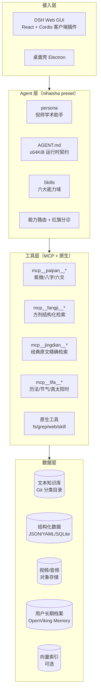
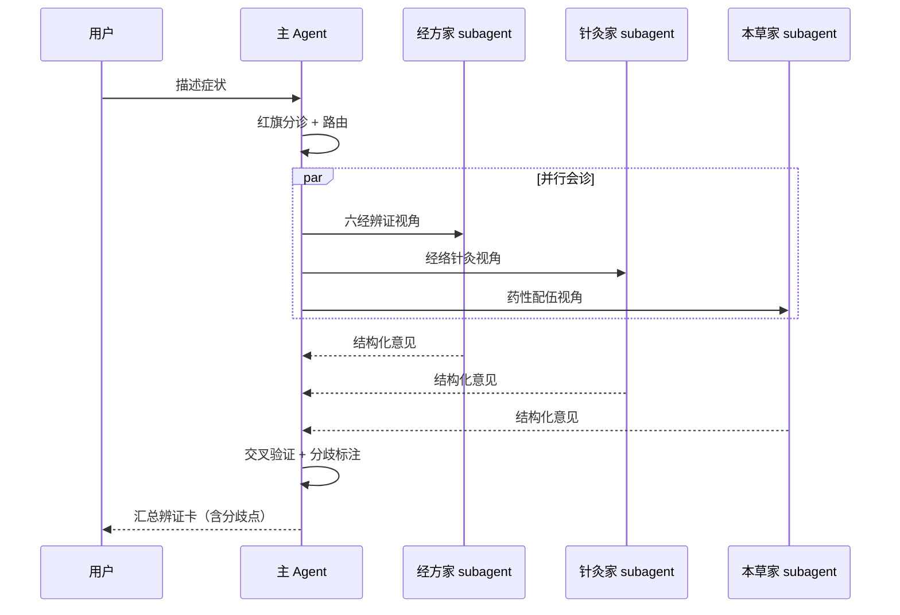

# 技术架构设计（DSH 底座）

> 配套文档：[产品设计书](../00-产品设计/01-产品设计书.md) ｜ [功能清单](../01-功能梳理/01-功能清单与优先级.md)
> 本文所有 DSH 结论均来自对本机安装包的实际读取与验证，关键处标注了验证方式。

---

## 1. 为什么选 DeepSeek Harness

DSH 不是「一个聊天框架」，而是一个 **Cordis 插件化 Agent 运行时**。对本项目，它提供了四项**恰好需要**的能力：

| 需求 | DSH 对应机制 | 验证来源 |
|---|---|---|
| 倪师专属人格与规则 | `persona` + `AGENT.md` 工作区指令 | `@deepseek-ai/dsh-persona`、`dsh-agent-instructions` |
| 六大能力域可插拔 | **Skills**（`SKILL.md` 目录包，支持热加载） | `dsh-skill-filesystem` README |
| 确定性排盘/检索外置 | **MCP 客户端**（stdio + streamable-http） | `dsh-mcp-client` README |
| 结构化输出卡片 | **GenUI**（` ```dsh-ui ` fence） | `@omdsh-dev/dsh-genui` |

---

## 2. 关键验证结论（务必先读）

### 2.1 ⚠️ `AGENT.md` 默认不会被加载

这是本次探查中**最重要的一条工程事实**。

`@deepseek-ai/dsh-agent-instructions` 的默认候选文件名是：

```
instructionFileCandidates:      ['AGENTS.md', 'CLAUDE.md']
localInstructionFileCandidates: ['AGENTS.local.md', 'CLAUDE.local.md']
```

**`AGENT.md`（单数）不在候选列表中**，因此项目根目录下的 `AGENT.md` 不会被注入模型上下文——它只是一份普通文档。

本机 profiles 的 `cordis.patch.yml` 均为空数组 `[]`，未覆盖该默认值，因此默认行为生效。

**解决方案（已验证可用）**：建立符号链接 `AGENTS.md -> AGENT.md`。

验证依据（引自 `dsh-agent-instructions` README）：

> 它会解析每个候选文件并对解析结果执行 stat，因此**会跟随路径最后一段的 symlink 到其目标**：指向常规文件的链接会加载目标内容。

**实证**：本项目创建 `AGENTS.md -> AGENT.md` 后，写入 `AGENT.md` 立即触发了 DSH 注入：

```
<system-reminder>
The following workspace instructions may be relevant to your work...
Instructions from: AGENTS.md
# 机制验证占位
PROBE-MARKER-NHX-ALPHA
</system-reminder>
```

这证明：**单一内容源（`AGENT.md`）+ 符号链接（`AGENTS.md`）= 可维护且真正生效**，无需维护两份副本。

### 2.2 指令预算 64 KiB

`vibe-coding` preset 配置 `maxBytes: 65536`。渲染时**优先保留最具体的文件**，先丢弃宽泛文件再截断最具体文件，并发出可见通知。

> **架构含义**：`AGENT.md` 是**每次都加载**的运行时契约，必须精简；长篇设计文档放 `docs/`，通过**上下文指针**按需加载。本项目即按此拆分。

### 2.3 项目根目录 = 最近的含 `.git` 祖先

本项目根目录即 `/Users/moks/Desktop/codes/idea/spark-nhx-master`。

---

## 3. 技术栈总览



---

## 4. Agent Preset 设计（`nihaisha`）

DSH 的自定义 preset 位于 `$DSH_HOME/.agent-presets/<name>/`，本机已有实例可作模板：`~/.dsh/.agent-presets/liangshen/`（含 `agent.cordis.yml` / `preset.yml` / `*.mjs`）。

### 4.1 目录结构

```
$DSH_HOME/.agent-presets/nihaisha/
├── preset.yml            # 名称、描述、排序（GUI 中展示）
├── agent.cordis.yml      # Cordis 组合（persona / 工具 / 技能 / 委派）
└── *.mjs                 # 可选的自定义插件
```

### 4.2 组合要点

| 行 ID | 包 | 作用 |
|---|---|---|
| `persona` | `@deepseek-ai/dsh-persona` | 倪师学术助手人格（含边界声明） |
| `agent-instructions` | `@deepseek-ai/dsh-agent-instructions` | 加载 `AGENT.md`，`maxBytes: 65536` |
| `skill-filesystem` | `@deepseek-ai/dsh-skill-filesystem` | 发现 `.dsh/skills/` 技能包，**热加载** |
| `tool-skill` | `@deepseek-ai/dsh-tool-skill` | 技能目录与按需加载 |
| `tool-fs` / `tool-fs-search` | 原生 | 读知识库、检索 |
| `tool-bash` | 原生 | 运行入库/检索脚本 |
| `mcp-*` | `@deepseek-ai/dsh-mcp-client` | 排盘、方剂、经典检索服务 |
| `tool-web` | `@deepseek-ai/dsh-tool-web` | 补充检索（默认 `fetch:false`） |
| `delegation` 组 | `dsh-tool-subagent` / `dsh-tool-workflow` | 多专家会诊 |
| memory | `@openviking/dsh-memory-plugin` | 用户长期档案 |

### 4.3 Skills 技能包设计

DSH 技能发现规则（验证自 `dsh-skill-filesystem` README）：

| Rank | 来源 | 路径 |
|---|---|---|
| 100 | project-dsh | `<projectRoot>/.dsh/skills` |
| 200 | project-agents | `<projectRoot>/.agents/skills` |
| 300 | custom | `Config.customSkillDirs` |
| 400 | user-dsh | `<dshHome>/skills` |

**格式**：目录包 `<name>/SKILL.md` 或平铺 `<name>.md`；`name` 必须 kebab-case；必填 frontmatter `name` + `description`，可选 `whenToUse`、`metadata`、`disable-model-invocation`、`user-invocable`。

> 观察到的根目录由 Chokidar 监视，**skill 改动无需重启**。

**本项目技能包规划**：

```
.dsh/skills/
├── nhx-triage/SKILL.md          # 红旗分诊（最高优先级，全局前置）
├── nhx-consult/SKILL.md         # 十问式问诊
├── nhx-bianzheng/SKILL.md       # 辨证卡输出规范
├── nhx-fangji/SKILL.md          # 方剂参考卡 + 剂量红线
├── nhx-jingdian/SKILL.md        # 经典原文精确检索与引用
├── nhx-fengshui/SKILL.md        # 风水分析
├── nhx-zhanbu/SKILL.md          # 占卜（含确定性起卦调用）
├── nhx-mingli/SKILL.md          # 算命（强制走 MCP 排盘）
└── nhx-learning/SKILL.md        # 学习路径与测验
```

> **`description` 是上下文指针**：它决定模型何时加载该技能。必须写清「做什么 + 何时触发」，用分支列举触发场景，不写同义重述。

---

## 5. MCP 服务设计（确定性计算外置）

### 5.1 配置形态（验证自 `dsh-mcp-client` README 原文）

```yaml
- id: mcp-paipan
  name: '@deepseek-ai/dsh-mcp-client'
  config:
    serverName: paipan
    transport: stdio
    command: node
    args: ['/path/to/nhx-paipan-server/dist/index.js']
    toolCallTimeoutMs: 30000

- id: mcp-fangji
  name: '@deepseek-ai/dsh-mcp-client'
  config:
    serverName: fangji
    transport: streamable-http
    url: http://localhost:8788/mcp
    headers:
      Authorization: !!js '`Bearer ${process.env.NHX_MCP_TOKEN}`'
    reconnect:
      enabled: true
      maxAttempts: 10
```

模型侧工具名为 `mcp__<serverName>__<rawName>`（如 `mcp__paipan__ziwei_chart`）。

### 5.2 三个必备服务

| 服务 | 工具 | 为什么必须确定性 |
|---|---|---|
| **paipan** | `ziwei_chart` `bazi_chart` `liuyao_cast` `meihua_cast` `bazhai_chart` | 农历转换、节气、真太阳时、闰月、大运起运 — **LLM 心算必错** |
| **jingdian** | `get_article` `search_article` `get_formula` | 经典原文必须**逐字精确**，不能向量近似或模型复述 |
| **lifa** | `solar_to_lunar` `jieqi_at` `true_solar_time` | 排盘与风水择日的公共基础 |

> **红线**：命理类回答若未经 `mcp__paipan__*` 出具命盘，不得输出任何星曜/干支结论。

### 5.3 术语表（供检索统一）

见 [知识库术语与命名规范](../02-资源管理/01-资源分类与OSS方案.md#6-术语与命名规范)。

---

## 6. GenUI 结构化输出

对话内渲染白名单组件（` ```dsh-ui ` fence）。本项目映射：

| 业务对象 | 组件组合 |
|---|---|
| 辨证卡 | `card` + `keyvalue`（主诉/框架/证型/置信度）+ `list`（支持/反对证据）+ `callout`（就医建议） |
| 方剂卡 | `card` + `table`（组成·原比例）+ `code`（原文引用）+ `callout`（禁忌，warning） |
| 十问问诊 | `col` + 分组 `radio`/`checkbox`/`slider` + `submit` |
| 命盘 | `table`（十二宫）或 `echart`；卦象用 `diagram` |
| 学习测验 | `quiz`（本地判分，零往返） |
| 引用溯源 | `keyvalue` / `copy` |

**原则**：能本地完成的状态变化（判卷、选中、展开）就地完成，`action` 只用于必须模型参与的环节。

---

## 7. 多专家会诊（P1）

利用 DSH 的委派能力，把复杂病例拆给多个**独立视角**的子代理，再汇总：



**价值**：多视角交叉验证能显著降低单一视角的过拟合；**明确标注分歧**比强行统一结论更诚实、更专业。

---

## 8. 知识库与检索架构

### 8.1 分层存储

| 类别 | 存储 | 理由 |
|---|---|---|
| 书籍、日志、经方、讲义 | **Git 仓库分类目录**（本仓库） | 小文件、需版本追溯、需 diff 审阅 |
| 结构化数据（方剂/本草/穴位） | JSON/YAML + SQLite | 精确查询 |
| 视频/音频 | **对象存储 OSS** | 大文件、CDN 分发、流量成本 |
| 向量索引 | 可选（本地 LanceDB / 服务端） | 语义检索 |

### 8.2 检索策略（重要）

| 数据 | 方式 | 红线 |
|---|---|---|
| 经典原文 | **精确检索**（条文号/篇名） | 逐字准确，禁止模型复述 |
| 方剂组成 | **结构化查询** | 原比例原样取出 |
| 汉唐文章 | 混合（BM25 + 向量） | 标注来源与日期 |
| 视频 | 元数据检索 + 时间戳跳转 | 视频本体在 OSS |

### 8.3 视频 OSS 方案

视频**不入库**，只入库**索引**：

```json
{
  "id": "renji-zhenjiu-012",
  "title": "针灸大成 第12讲",
  "series": "人纪",
  "ossKey": "nhx/renji/zhenjiu/012.mp4",
  "durationSec": 3600,
  "segments": [
    { "start": 0,    "end": 480,  "topic": "足三里定位" },
    { "start": 480,  "end": 1200, "topic": "捻转补泻手法" }
  ],
  "transcriptKey": "nhx/renji/zhenjiu/012.transcript.json"
}
```

索引留本地（可 Git 版本化、可检索），媒体本体在 OSS（海量、低成本）。

> **进阶**：转录文本（transcript）应**回流入知识库**——视频内容因此变得可全文检索、可引用时间戳。这是「视频知识化」的关键一步。

---

## 9. 用户长期档案（Memory）

中医的核心是**长期调理与复诊对比**，因此记忆不是锦上添花，而是产品骨架。

本机已安装 `@openviking/dsh-memory-plugin`（profile 补丁已挂载），可直接复用。

档案结构：

```
用户档案
├── 基础信息（性别、年龄区间、地域、体质倾向）
├── 问诊记录[]（时间、主诉、十问结果、舌象图引用）
├── 辨证结论[]（证型、置信度、依据）
├── 调理记录[]（所用方、时长、反馈）
└── 复诊对比（本次 vs 上次变化）
```

**合规**：健康数据属《个人信息保护法》**敏感个人信息**，需**单独同意**、最小必要、加密存储、可删除。

---

## 10. 多用户服务化（待评估，P1）

现状：DSH 设计为**本机工作台**（单一 `DSH_HOME`，会话按 session 键控）。

面向「为用户提供服务」需要评估：

| 方案 | 说明 | 工作量 |
|---|---|---|
| A. 单机 + 前端多用户 | DSH 作后端引擎，自建 Web 层做账号与隔离 | 中 |
| B. 多 Profile 隔离 | 每用户一个 DSH profile | 高（资源占用大） |
| C. Session 级隔离 | 复用 `dsh-api-gateway`（Typert RPC）+ 自建鉴权 | 中高 |

> `dsh-api-gateway` 提供 Host↔Client 的 Typert RPC 与 `/api` FetchHandler，是自建服务层的合理接入点。**建议先做 A 方案验证产品价值，再决定是否重投入。**

---

## 11. 项目目录结构

```
spark-nhx-master/
├── AGENT.md                    # ★ 运行时契约（真正被加载）
├── AGENTS.md -> AGENT.md       # ★ 符号链接（DSH 发现入口）
├── README.md
├── docs/                       # 设计与研究文档（按需加载）
│   ├── 00-产品设计/
│   ├── 01-功能梳理/
│   ├── 02-资源管理/
│   ├── 03-技术架构/
│   └── research/
├── knowledge/                  # ★ 文本知识库（Git 版本化）
│   ├── 01-人纪-中医经典/
│   ├── 02-天纪-术数/
│   ├── 03-汉唐文章/
│   ├── 04-经方方剂/
│   ├── 05-倪师日志讲义/
│   └── 06-结构化数据/
├── media/                      # 媒体索引（本体在 OSS）
│   ├── 视频索引/
│   └── 音频索引/
├── .dsh/skills/                # ★ DSH 技能包（热加载）
└── src/                        # 应用与 MCP 服务源码
```

---

## 12. 技术风险与对策

| 风险 | 影响 | 对策 |
|---|---|---|
| **LLM 历法推算错误** | 命理产品致命 | 强制 MCP 确定性排盘；无命盘不出结论 |
| **模型篡改经典原文** | 信任崩塌 | 原文一律从结构化数据**原样取出**，禁止复述 |
| **剂量越界** | 法律风险 | 提示词红线 + 输出后置校验 + 回归测试用例 |
| **红旗漏检** | 生命安全 | 规则前置（非模型判断）+ 100% 召回测试门槛 |
| **提示词预算超限** | 契约被截断 | `AGENT.md` 严格精简，长文外置 |
| **内容版权** | 上线阻塞 | 优先使用授权/公开内容；建立来源台账 |
| **多用户改造量** | 工期风险 | 先单机验证，再服务化 |

---

## 13. 已验证事实清单（可复现）

| # | 结论 | 验证方式 |
|---|---|---|
| 1 | `AGENT.md` 不在默认候选列表 | 读 `dsh-agent-instructions` README + package.json |
| 2 | symlink 会被跟随加载 | README 原文 + 本项目实证（注入成功） |
| 3 | 指令预算 64 KiB | `config/agent-presets/vibe-coding/agent.cordis.yml` 第 `agent-instructions` 行 |
| 4 | 本机 profiles 未覆盖候选名 | `~/.dsh/profiles/{web,desktop}/cordis.patch.yml` 均为 `[]` |
| 5 | Skills 发现 5 个根，热加载 | `dsh-skill-filesystem` README |
| 6 | skill 需 kebab-case + `name`/`description` | 同上 |
| 7 | MCP 支持 stdio 与 streamable-http | `dsh-mcp-client` README |
| 8 | 工具命名 `mcp__<server>__<tool>` | 同上 |
| 9 | 附件支持 PNG/JPEG/WebP/GIF | `dsh-attachment` README |
| 10 | 自定义 preset 路径与结构 | `~/.dsh/.agent-presets/liangshen/` 实例 |
| 11 | 默认 preset 由 `agent-presets.default` 控制 | `~/.dsh/settings.yaml` |
| 12 | memory 插件可用 | `~/.dsh/profiles/desktop/node_modules/@openviking/dsh-memory-plugin` |
